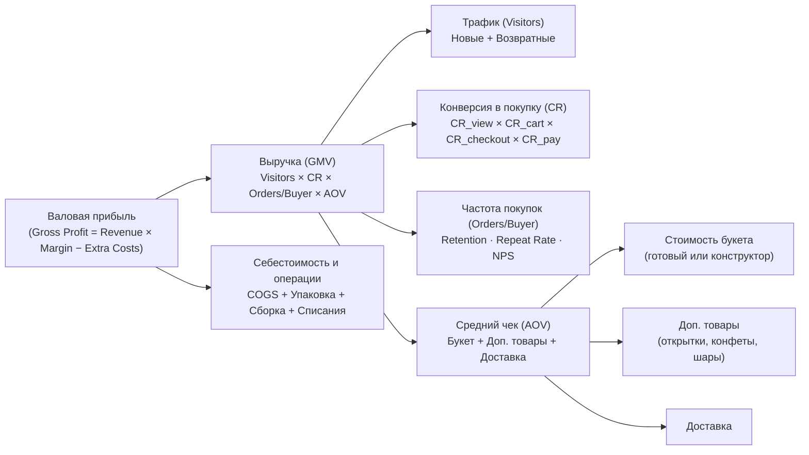
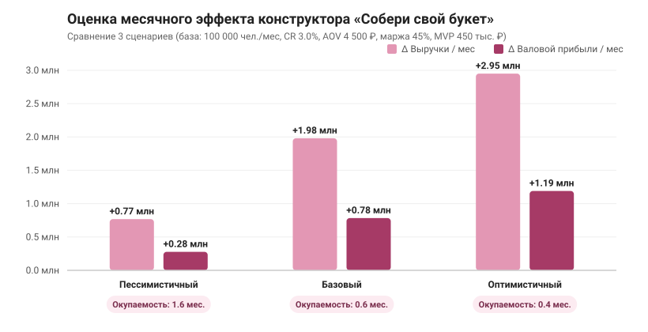
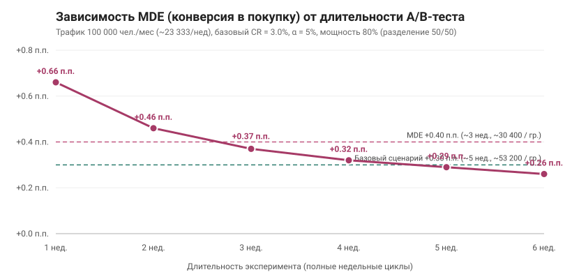
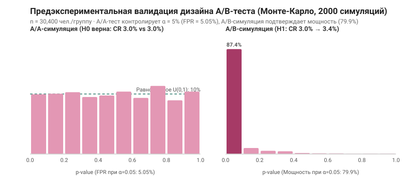

# Продуктовый анализ и дизайн A/B-теста конструктора букетов для `roza4u.ru`

> **Автор:** Юлия Богодяж (МФТИ, ФПМИ) · [GitHub](https://github.com/uliiai) · [Telegram](https://t.me/aiilaiu)
> **Формат:** продуктовый кейс (e-commerce, доставка цветов) · **Инструменты:** Python (`pandas`, `NumPy`, `Plotly`), продуктовые метрики, юнит-экономика, дизайн A/B-тестов

---

## Executive Summary (TL;DR)

- **Объект анализа:** интернет-магазин доставки цветов по Москве и МО [`roza4u.ru`](https://roza4u.ru) (ключевое УТП — *«Доставка за 90 минут»* и гарантия свежести от 5 дней).
- **Продуктовая проблема:** сейчас пользователь может либо выбрать готовый букет из каталога, либо добавить в корзину поштучные цветы — но **без возможности собрать их в единый букет с выбранной упаковкой**. При попытке скомбинировать разные сорта поштучно каждый вид оформляется отдельно либо вовсе без упаковки.
- **Предлагаемое решение (MVP):** добавить на сайт пошаговый конструктор **«Собери свой букет»** на базе существующего ассортимента поштучных цветов (выбор сортов и количества → выбор упаковки/ленты → динамический расчёт цены → добавление в корзину как единой позиции).
- **Оценка эффекта (юнит-экономика в 3 сценариях):** декомпозиция эффекта через долю пользователей конструктора (`adoption = 15–25%`) с учётом валовой маржи (~45%), доп. затрат на индивидуальную сборку (`120 ₽/заказ`) и разовой стоимости MVP (`450 тыс. ₽`) показывает прирост валовой прибыли от **+277 тыс. ₽/мес** (пессимистичный сценарий, окупаемость **1.6 мес.**) до **+783 тыс. ₽/мес** в базовом сценарии (окупаемость **~0.6 мес.**).
- **Проверка гипотезы (дизайн A/B-теста):** разделение по `user_id` (50/50), ключевая метрика — **CR в оплаченный заказ** (вторичные: `ARPU`, `AOV`, `Adoption конструктора`), строгие **guardrail-метрики** (доля доставок позже 90 мин, время сборки, списания готовых букетов, жалобы «ожидание vs реальность»). При трафике `100 000 чел./мес` для детекции MDE `+0.40 п.п.` (`30 390` чел./группу, $\alpha=5\%$, мощность $80\%$) требуется **3 полных недели** (а для базового эффекта `+0.30 п.п.` — **5 недель** либо ускорение через CUPED по `ARPU`).

---

## Структура репозитория

```text
product-analytics-roza4u-case/
├── README.md                                  # Полный разбор кейса и ключевые выводы
├── notebooks/
│   └── ab_test_and_unit_economics.ipynb       # Расчёты юнит-экономики, MDE, sample size и A/A-валидация
├── scripts/
│   └── generate_artifacts.py                  # Воспроизводимый скрипт расчётов и генерации графиков
├── images/
│   ├── unit_economics_scenarios.svg           # Сравнение 3 сценариев (выручка, прибыль, окупаемость)
│   ├── ab_mde_duration.svg                    # Кривая зависимости MDE от длительности теста
│   └── aa_power_validation.svg                # Предэкспериментальная A/A и A/B Монте-Карло валидация
├── presentation/                              # Папка для PDF-презентации кейса (экспорт из Miro)
└── requirements.txt                           # Зависимости Python
```

---

## 1. Контекст бизнеса и дерево метрик

`roza4u.ru` работает в высококонкурентном сегменте экспресс-доставки цветов (Москва и область). Ключевые драйверы бизнеса — скорость доставки (SLA 90 минут), конверсия первого визита (срочный подарок), средний чек и возвращаемость клиентов к следующим поводам.

Вместо простой группировки показателей дерево метрик построено как **математическая декомпозиция выручки и валовой прибыли**:



---

## 2. Пользовательский путь и план трекинга событий

| Шаг воронки | Действие пользователя | Типичные точки отвала (боли) | События для трекинга (`Event Tracking`) |
| :--- | :--- | :--- | :--- |
| 1. Поиск и выбор | Открытие каталога / фильтров («Подобрать букет») | Нет нужного сочетания цветов или нужного бюджета среди готовых букетов | `page_view`, `filter_apply`, **`open_builder`** |
| 2. Карточка / Конструктор | Просмотр букета или подбор цветов и упаковки в конструкторе | Поштучные цветы нельзя объединить в один оформленный букет; риск «паралича выбора» | `view_item`, **`builder_add_flower`**, **`builder_select_packaging`** |
| 3. Корзина | Добавление позиции и проверка состава/итоговой суммы | Неожиданная стоимость доставки или разрозненные позиции поштучных цветов | `add_to_cart`, **`builder_add_to_cart`**, `view_cart` |
| 4. Оформление | Ввод адреса, времени доставки (SLA 90 мин) и контактов | Длинная форма, недоступность нужного слота доставки | `begin_checkout`, `select_delivery_slot` |
| 5. Оплата | Онлайн-оплата заказа | Технические сбои оплаты, сомнения в финальном виде букета | `add_payment_info`, **`purchase`** |
| 6. Пост-покупка | Сборка флористом, доставка, фото букета и отзыв | Опоздание > 90 мин, несоответствие «ожидание vs реальность» | `order_assembled`, `order_delivered`, `review_submitted` |

---

## 3. Продуктовая гипотеза и MVP

### Гипотеза (формат *If – Then – Because*)
> **Если** добавить на сайт пошаговый конструктор **«Собери свой букет»** (выбор поштучных цветов, их количества и единой упаковки), **то** вырастут конверсия в оплаченный заказ (`CR`) и средний чек (`AOV`) за счёт пользователей с конкретным запросом по составу/бюджету, **потому что** сейчас такие клиенты вынуждены либо покупать неупакованные цветы поштучно, либо уходить к конкурентам.

### Скоуп MVP (без долгой 3D-разработки)
1. Точка входа в главном меню и блоке «Подобрать букет» (рядом с фильтрами готовых букетов).
2. Выбор цветов из уже имеющегося на сайте каталога поштучных позиций с индикацией актуального остатка и рекомендованных сочетаний (снижение «паралича выбора»).
3. Выбор единой упаковки (плёнка / крафт / лента) и опциональной открытки.
4. Динамический расчёт итоговой цены и добавление в корзину как **одной позиции** «Индивидуальный букет» (с передачей состава флористу в заказе).
5. Обязательная отправка фото собранного букета клиенту перед выездом курьера (снижение риска жалоб «ожидание vs реальность»).

---

## 4. Система метрик эксперимента

| Категория | Метрики | Зачем отслеживаем |
| :--- | :--- | :--- |
| **Целевая (Primary)** | **CR в оплаченный заказ** (дополнительно контролируем **ARPU**) | Основной критерий успеха: конструктор должен увеличивать долю покупателей, не снижая выручку на пользователя. |
| **Вторичные (Secondary)** | `AOV`, `Adoption конструктора` (доля посетителей, открывших фичу), `CR из конструктора в корзину`, `Repeat Purchase Rate` (в долгосрочном окне 30–90 дней) | Понимание механики эффекта: сколько людей пользуются конструктором и как меняется структура чека. |
| **Ограничения (Guardrails)** | • Доля заказов с доставкой **> 90 мин** (SLA)<br>• Среднее время сборки букета флористом<br>• Доля жалоб / возвратов («ожидание vs реальность»)<br>• Списание готовых витринных букетов и **общая валовая маржа** | Контроль операционной нагрузки и рисков каннибализации: каннибализация готовых букетов допустима только при росте суммарной валовой прибыли. |

---

## 5. Юнит-экономика и оценка эффекта (3 сценария)

### Базовые допущения (1 месяц)
- Посещаемость сайта: **100 000** уникальных пользователей/мес (`~23 333`/нед)
- Текущая конверсия в покупку: **3.0%** (`3 000` заказов/мес) · Текущий средний чек: **4 500 ₽**
- Текущая выручка: **13 500 000 ₽/мес** · Базовая валовая маржа: **45%** (**6 075 000 ₽/мес**)
- Дополнительные операционные затраты на 1 кастомный букет (увеличенное время сборки + упаковка): **120 ₽/заказ**
- Разовая стоимость разработки и запуска MVP: **450 000 ₽**

Эффект моделируется честно через **долю пользователей конструктора (`adoption`)**, а не через равномерный сдвиг всего трафика сайта:

| Сценарий | Adoption | CR в конструкторе | Общий CR сайта | Общий AOV | ARPU | Δ Выручки / мес | Δ Валовой прибыли / мес | Окупаемость MVP | ROI (6 мес.) |
| :--- | :---: | :---: | :---: | :---: | :---: | :---: | :---: | :---: | :---: |
| **Пессимистичный** | 15% | 3.8% | **3.12%** (+0.12 п.п.) | 4 573 ₽ | 142.7 ₽ | +768 тыс. ₽ | **+277 тыс. ₽** | **1.6 мес.** | +270% |
| **Базовый** | 20% | 4.5% | **3.30%** (+0.30 п.п.) | 4 691 ₽ | 154.8 ₽ | +1.98 млн ₽ | **+783 тыс. ₽** | **0.6 мес.** | +944% |
| **Оптимистичный** | 25% | 4.6% | **3.40%** (+0.40 п.п.) | 4 838 ₽ | 164.5 ₽ | +2.95 млн ₽ | **+1.19 млн ₽** | **0.4 мес.** | +1 486% |



> **Ключевой инсайт:** даже при консервативном `adoption = 15%` и учёте дополнительных расходов на сборку (`120 ₽/букет`), MVP окупается менее чем за 2 месяца.

---

## 6. Дизайн A/B-теста и валидация до запуска

### Основные параметры эксперимента
- **Единица рандомизации:** `user_id` / persistent cookie (чтобы один пользователь не видел разные версии сайта между сессиями).
- **Разделение трафика:** 50% контроль (текущая версия сайта) / 50% тест (доступ к конструктору «Собери свой букет»).
- **Уровень значимости и мощность:** $\alpha = 5\%$ (двусторонний), мощность $1 - \beta = 80\%$.
- **Статистические критерии:**
  - `CR в оплаченный заказ` — двусторонний z-тест пропорций;
  - `ARPU` и `AOV` (метрика отношения) — t-тест Уэлча / бутстреп (с винзоризацией или фильтрацией аномальных B2B-заказов);
  - При одновременной оценке нескольких метрик — поправка на множественное тестирование (**метод Холма**);
  - Для ускорения оценки по `ARPU` при наличии истории возвратных клиентов — снижение дисперсии через **CUPED**.
- **Ограничения по календарю:** тест **нельзя** запускать в цветочные пики (14 февраля, 8 марта, 9 мая, 1 сентября, День матери) из-за искажённого спроса и перегрузки флористов.

### Размер выборки и длительность (почему 2 недель недостаточно)

| Целевой эффект (MDE по CR) | Выборки на 1 группу | Всего пользователей | Расчётная длительность (при 100k/мес) | Рекомендуемое окно |
| :--- | :---: | :---: | :---: | :---: |
| **+0.40 п.п.** (3.0% → 3.4%, оптимистичный) | `30 390` | `60 780` | 2.6 недели | **3 полных недели** |
| **+0.30 п.п.** (3.0% → 3.3%, базовый) | `53 211` | `106 422` | 4.6 недели | **5 полных недель** |

> За 2 недели наберётся лишь ~46 700 пользователей суммарно (~23 300 на группу), что позволяет детектировать только эффект от **+0.46 п.п.** (+15.3% отн.). Поэтому минимальная рекомендуемая длительность для MDE `+0.40 п.п.` — **3 полных недельных цикла** (70 000 пользователей, фактический MDE `+0.37 п.п.`).



### Предэкспериментальная валидация дизайна (Монте-Карло, 2 000 симуляций)
До запуска реального теста в [ноутбуке](notebooks/ab_test_and_unit_economics.ipynb) проведена синтетическая проверка корректности z-критерия при `n = 30 400` на группу:
- **A/A-симуляция ($H_0$ верна):** распределение p-value равномерно на $[0, 1]$, эмпирический уровень ложноположительных срабатываний `FPR = 5.05%` (контроль $\alpha = 5\%$ соблюдается).
- **A/B-симуляция ($H_1$: CR `3.0% → 3.4%`):** эмпирическая мощность `79.9%` (подтверждает расчётные `80%`).
- После запуска эксперимента обязательна проверка **SRM (Sample Ratio Mismatch)** критерием $\chi^2$ перед анализом метрик.



### Матрица принятия решений по итогам A/B-теста

| Итог по Primary (`CR` / `ARPU`) | Состояние Guardrail-метрик | Решение |
| :--- | :--- | :--- |
| Статзначимый рост (`p < 0.05`) | Guardrails в норме (опоздания > 90 мин не выросли, маржа не просела) | **Раскатываем** на 100% трафика и планируем v2 (пресеты букетов, апселл открыток/конфет). |
| Статзначимый рост | Просел SLA доставки или выросло число жалоб «ожидание vs реальность» | **Дорабатываем операционку** (ограничиваем число сортов в конструкторе, добавляем обязательное согласование фото), затем перезапускаем тест. |
| Эффект не значим или отрицательный | Любое | **Не раскатываем**; анализируем воронку конструктора по шагам (где отвал — на выборе цветов, упаковке или цене), тестируем упрощённый UX. |

---

## Как воспроизвести расчёты локально

```bash
pip install -r requirements.txt
python scripts/generate_artifacts.py
```

Открыть ноутбук с интерактивными графиками Plotly:
```bash
jupyter notebook notebooks/ab_test_and_unit_economics.ipynb
```
